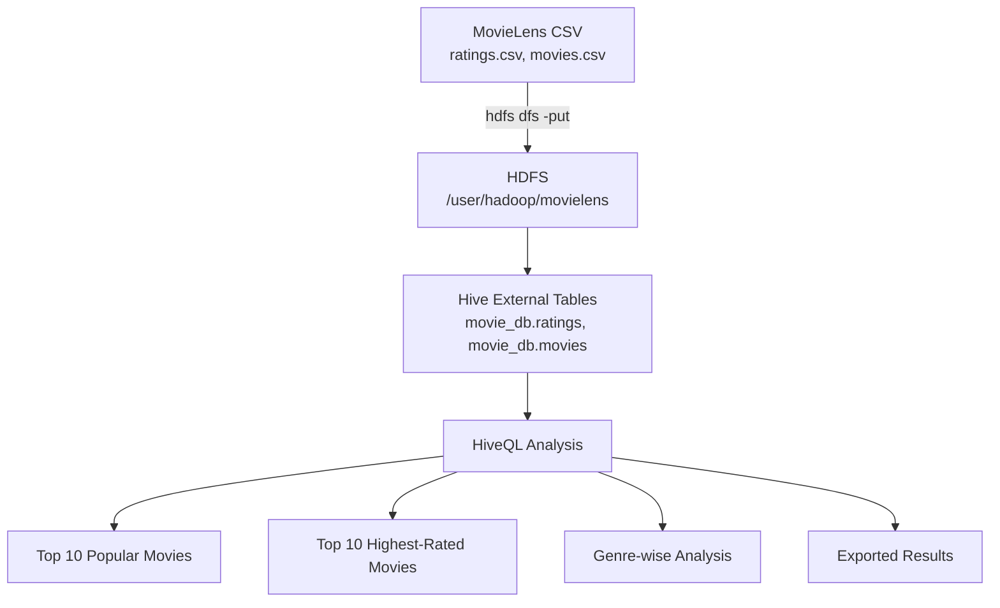

# Movie Rating Analysis using Hadoop and Hive

**Distributed analytics on the MovieLens dataset with HDFS, Apache Hive, and HiveQL.**

This project implements a complete Big Data workflow: raw MovieLens CSV files are stored in **HDFS**, exposed through **Hive external tables**, and analyzed with **HiveQL** in a pseudo-distributed Hadoop environment. It demonstrates distributed storage, SQL-style querying over HDFS, and the transformation of multi-valued fields.

<p>


</p>

---

## Table of Contents

- [Overview](#overview)
- [Objectives](#objectives)
- [Tech Stack](#tech-stack)
- [Architecture](#architecture)
- [Dataset](#dataset)
- [Repository Structure](#repository-structure)
- [Prerequisites](#prerequisites)
- [Setup](#setup)
- [HDFS Layout](#hdfs-layout)
- [Hive Tables](#hive-tables)
- [Analysis Queries](#analysis-queries)
- [Running the Project](#running-the-project)
- [Verification](#verification)
- [Troubleshooting](#troubleshooting)
- [Learning Outcomes](#learning-outcomes)
- [Future Enhancements](#future-enhancements)
- [Author](#author)

---

## Overview

MovieLens rating data can grow large and is awkward to process with traditional single-machine tools. This project stores the dataset in **HDFS**, defines **external Hive tables** over it, and runs **HiveQL** aggregations to answer practical questions about popularity, ratings, and genres.

The project runs on a **pseudo-distributed Hadoop** installation (HDFS + YARN + MapReduce) with **Apache Hive** as the SQL layer and an **Apache Derby** metastore.

## Objectives

1. Understand the Hadoop ecosystem and its components.
2. Configure a pseudo-distributed Hadoop environment.
3. Configure HDFS for distributed storage and YARN for resource management.
4. Install and configure Apache Hive with a Derby metastore.
5. Upload the MovieLens dataset into HDFS.
6. Create Hive external tables over the HDFS data.
7. Perform analytical queries with HiveQL.
8. Export and interpret the results.

## Tech Stack

| Component | Technology |
|---|---|
| Operating System | Arch Linux x86_64 |
| Java | OpenJDK 8 |
| Hadoop | Apache Hadoop 3.3.6 |
| Storage | HDFS (`hdfs://localhost:9000`) |
| Resource Management | YARN |
| Processing | Hadoop MapReduce |
| Data Warehouse | Apache Hive 3.1.3 |
| Metastore | Apache Derby |
| Query Language | HiveQL |
| Dataset | MovieLens |
| Shell | Fish (setup snippets) / Bash |

## Architecture



The query engine reads data directly from HDFS; external tables keep the physical data independent of the table definitions.

## Dataset

The project uses the **MovieLens** dataset (available from [GroupLens](https://grouplens.org/datasets/movielens/)). Files live in [`data/`](data/):

| File | Rows (approx.) | Description |
|---|---|---|
| `ratings.csv` | 100k+ | `userId`, `movieId`, `rating`, `review_time` |
| `movies.csv` | 9k+ | `movieId`, `title`, `genres` |
| `links.csv` | 9k+ | External ID mappings (IMDb, TMDb) |
| `tags.csv` | — | User-applied free-text tags |

### Schemas

**ratings.csv**

```text
userId,movieId,rating,review_time
1,1,4.0,964982703
1,3,4.0,964981247
```

| Column | Type | Description |
|---|---|---|
| `userId` | INT | User identifier |
| `movieId` | INT | Movie identifier |
| `rating` | FLOAT | Rating (0.5–5.0) |
| `review_time` | BIGINT | Unix timestamp |

**movies.csv**

```text
movieId,title,genres
1,Toy Story (1995),Adventure|Animation|Children|Comedy|Fantasy
2,Jumanji (1995),Adventure|Children|Fantasy
```

| Column | Type | Description |
|---|---|---|
| `movieId` | INT | Movie identifier |
| `title` | STRING | Movie title |
| `genres` | STRING | Pipe-separated genres |

The two tables are joined on `movieId`.

> Large datasets are git-ignored. See [`.gitignore`](.gitignore); download the dataset separately if needed.

## Repository Structure

```text
Movie-rating-analysis/
├── data/
│   ├── README.md          # dataset documentation
│   ├── ratings.csv
│   ├── movies.csv
│   ├── links.csv
│   └── tags.csv
├── hive/
│   ├── create_tables.sql  # database + external table definitions
│   └── analysis_queries.sql
├── setup/
│   ├── 01-clean-install.md   # Java, Hadoop install
│   ├── 02-hadoop-config.md   # core/hdfs/mapred/yarn config
│   └── 03-hive-config.md     # Hive install and metastore
├── .gitignore
└── README.md
```

## Prerequisites

- Arch Linux (or comparable Linux distribution)
- OpenJDK **8** (required for Hadoop 3.3.6 / Hive 3.1.3 compatibility)
- Apache Hadoop **3.3.6**
- Apache Hive **3.1.3**
- ~4 GB RAM recommended for the pseudo-distributed stack

## Setup

Detailed, copy-paste instructions are in [`setup/`](setup/):

1. [Clean installation](setup/01-clean-install.md) — remove old installs, install Java 8 and Hadoop 3.3.6, configure log directories.
2. [Hadoop configuration](setup/02-hadoop-config.md) — `core-site.xml`, `hdfs-site.xml`, `mapred-site.xml`, `yarn-site.xml`, NameNode format, service startup.
3. [Hive configuration](setup/03-hive-config.md) — install Hive 3.1.3, set `HIVE_HOME`, configure the Derby metastore, sync Guava, initialize the schema.

Key configuration values used:

```xml
<!-- core-site.xml -->
<property>
    <name>fs.defaultFS</name>
    <value>hdfs://localhost:9000</value>
</property>

<!-- hdfs-site.xml -->
<property>
    <name>dfs.replication</name>
    <value>1</value>
</property>
```

```xml
<!-- mapred-site.xml -->
<property>
    <name>mapreduce.framework.name</name>
    <value>yarn</value>
</property>
```

```xml
<!-- yarn-site.xml -->
<property>
    <name>yarn.nodemanager.aux-services</name>
    <value>mapreduce_shuffle</value>
</property>
```

## HDFS Layout

```text
/user/hadoop/movielens/
├── ratings/
│   └── ratings.csv
└── movies/
    └── movies.csv
```

Create the directories and upload the data:

```bash
hdfs dfs -mkdir -p /user/hadoop/movielens/ratings
hdfs dfs -mkdir -p /user/hadoop/movielens/movies

hdfs dfs -put -f data/ratings.csv /user/hadoop/movielens/ratings/
hdfs dfs -put -f data/movies.csv  /user/hadoop/movielens/movies/
```

## Hive Tables

`hive/create_tables.sql` creates the database and two **external** tables. External tables are used because the physical files remain in HDFS and are managed independently of Hive.

```sql
CREATE DATABASE IF NOT EXISTS movie_db;
USE movie_db;

CREATE EXTERNAL TABLE IF NOT EXISTS ratings (
    userId INT,
    movieId INT,
    rating FLOAT,
    review_time BIGINT
)
ROW FORMAT DELIMITED
FIELDS TERMINATED BY ','
LOCATION '/user/hadoop/movielens/ratings'
TBLPROPERTIES ("skip.header.line.count"="1");

CREATE EXTERNAL TABLE IF NOT EXISTS movies (
    movieId INT,
    title STRING,
    genres STRING
)
ROW FORMAT DELIMITED
FIELDS TERMINATED BY ','
LOCATION '/user/hadoop/movielens/movies'
TBLPROPERTIES ("skip.header.line.count"="1");
```

`skip.header.line.count` tells Hive to ignore the CSV header row.

## Analysis Queries

`hive/analysis_queries.sql` implements three analyses.

### 1. Top 10 most popular movies

Ranks movies by number of ratings.

```sql
SELECT m.title, COUNT(r.rating) AS review_count
FROM ratings r
JOIN movies m ON r.movieId = m.movieId
GROUP BY m.title
ORDER BY review_count DESC
LIMIT 10;
```

### 2. Top 10 highest-rated movies

Averages ratings but requires at least **2,000 reviews** to avoid low-sample bias.

```sql
SELECT m.title,
       ROUND(AVG(r.rating), 2) AS avg_rating,
       COUNT(r.rating) AS total_reviews
FROM ratings r
JOIN movies m ON r.movieId = m.movieId
GROUP BY m.title
HAVING total_reviews >= 2000
ORDER BY avg_rating DESC
LIMIT 10;
```

### 3. Genre-wise analysis

Splits the pipe-separated `genres` field into rows with `SPLIT`, `EXPLODE`, and `LATERAL VIEW`, then aggregates per genre.

```sql
SELECT
    genre,
    COUNT(r.rating) AS rating_count,
    ROUND(AVG(r.rating), 2) AS avg_genre_rating
FROM ratings r
JOIN (
    SELECT movieId, genre
    FROM movies
    LATERAL VIEW explode(split(genres, '\\|')) genre_table AS genre
) m
    ON r.movieId = m.movieId
GROUP BY genre
ORDER BY rating_count DESC;
```

## Running the Project

```bash
# 1. Start the Hadoop services
start-dfs.sh
start-yarn.sh
jps    # expect NameNode, DataNode, SecondaryNameNode, ResourceManager, NodeManager

# 2. Create Hive tables
hive -f hive/create_tables.sql

# 3. Run the analysis
hive -f hive/analysis_queries.sql
```

You can also open the Hive shell and paste queries interactively:

```bash
hive
USE movie_db;
SHOW TABLES;
SELECT * FROM ratings LIMIT 10;
```

## Verification

| Check | Command |
|---|---|
| Hadoop daemons running | `jps` |
| HDFS directories | `hdfs dfs -ls -h /user/hadoop/movielens` |
| Uploaded file sizes | `hdfs dfs -ls -h /user/hadoop/movielens/ratings` |
| Hive database | `SHOW DATABASES;` |
| Hive tables | `SHOW TABLES;` |
| Table schema | `DESCRIBE ratings;` |
| Sample data | `SELECT * FROM movies LIMIT 10;` |

## Troubleshooting

| Symptom | Cause | Fix |
|---|---|---|
| `java.lang.UnsupportedClassVersionError` | Java version mismatch | Set `JAVA_HOME` to Java 8 |
| `Connection refused` to `localhost:9000` | NameNode not running | Start HDFS and check `jps` |
| Hive fails on start | Guava version mismatch | Replace Hive's Guava with Hadoop's (see setup guide) |
| Metastore errors | Derby schema not initialized | Run `schematool -dbType derby -initSchema` |
| Duplicate rows after `put` | Re-uploaded file | Use `hdfs dfs -put -f` to overwrite |
| Query returns empty tables | Wrong `LOCATION` in DDL | Match the HDFS path exactly |

## Learning Outcomes

- Distributed storage with HDFS and resource management with YARN
- Defining Hive external tables over HDFS data
- HiveQL joins and aggregation (`COUNT`, `AVG`, `ROUND`, `GROUP BY`, `HAVING`)
- Transforming multi-valued fields with `SPLIT`, `EXPLODE`, and `LATERAL VIEW`
- Exporting analytical results for reporting and visualization
- Operating a pseudo-distributed Hadoop + Hive stack

## Future Enhancements

- Time-based rating trend analysis
- Dashboards from Hive output (e.g., Python + matplotlib)
- Comparison with Apache Spark
- Recommendation-system experiments
- Automated end-to-end data loading

## Author

**Gokulakrishnan G**
[GitHub](https://github.com/Gokulgk6) · [LinkedIn](https://linkedin.com/in/gokulgk64)

## License

Released under the [MIT License](LICENSE).
